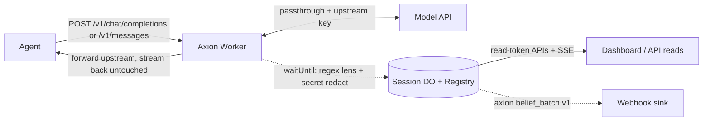

<div align="center">

# Axion

Agent cognitive middleware. A proxy that reads what an agent believes from its own model output, in real time, with no code changes to the agent.

**The open, local-first agent observability + collaboration stack: record, replay, diff, and inspect agent behavior - then plan and ship with humans in the same workspace.**

**by LatticeAG**

[](https://workers.cloudflare.com/)
[](https://www.typescriptlang.org/)
[](./LICENSE)
[](https://github.com/LatticeAG/Axion)

<p align="center">
  <a href="#quick-start">Quick Start</a> ·
  <a href="#why-axion">Why Axion</a> ·
  <a href="#how-it-works">How It Works</a> ·
  <a href="#what-is-shipped">Features</a> ·
  <a href="#configuration">Configuration</a> ·
  <a href="#verification">Verification</a> ·
  <a href="#file-structure">File Tree</a> ·
  <a href="#known-issues">Known Issues</a>
</p>

</div>

---

## What this is

Axion is a Cloudflare Worker that sits in front of a model API. Point an agent at it by overriding the base URL. The Worker forwards each request upstream and streams the response straight back with zero added latency. After the response is delivered, a regex lens pulls reasoning fragments from visible assistant text, stamps them with a linguistic confidence score, and stores them per session.

What ships today is a regex lens behind a transparent proxy. It is not a LangSmith replacement, not a prompt playground, not an eval harness, and not a hosted SaaS. Inspection, not another trace backend.

```
Agent  <->  Axion (CF Worker)  <->  Model API
```

---

## Why Axion

- **Zero instrumentation** - point an existing agent at Axion by overriding the base URL. No code changes, no SDK, no upload.
- **Zero added latency** - `ReadableStream.tee()` streams the upstream response straight back untouched; belief extraction runs in `waitUntil()` after delivery.
- **The "why" layer** - trace backends record what an agent *did*. Axion reads what the agent *believed* from its own streamed output: assumptions, intentions, contradictions, self-corrections.
- **Local-first inspection** - per-session belief timelines behind your own read token on your own Worker. Export JSON for a snapshot; nothing is a hosted SaaS.
- **Feeds your stack, doesn't replace it** - belief batches map onto Langfuse generation-span metadata and Honeycomb/OTLP events instead of competing with them.

### How Axion is different

Hosted agent-observability platforms detect what agents did wrong from traces, tool calls, and post-hoc reconstruction. Axion reads what agents believed in real time from the model's own output, self-hosted, MIT-licensed. See [How this compares](#how-this-compares).

## How It Works



1. The agent sends a normal OpenAI or Anthropic request through Axion (base URL override + `x-axion-session` header).
2. Axion forwards it upstream and streams the response back with zero added latency.
3. After delivery, the regex lens extracts belief fragments from visible assistant text, stamps linguistic confidence, redacts secrets, and stores the batch in the session Durable Object.
4. You inspect via the dashboard or read APIs (`GET /api/beliefs/:id`, SSE replay, export) - all behind `AXION_READ_TOKEN`.

---

## What is shipped

- **OpenAI Chat Completions proxy.** `POST /v1/chat/completions`, streaming and non-streaming. Default base `https://api.openai.com`.
- **Anthropic Messages proxy.** `POST /v1/messages`, streaming and non-streaming. Default base `https://api.anthropic.com`. Legacy `UPSTREAM_API_URL` overrides OpenAI only.
- **Passthrough auth.** Forward the caller's `Authorization` or `x-api-key`. Fall back to the `UPSTREAM_API_KEY` secret only when it is set. Anthropic Bearer tokens are also copied to `x-api-key`. Never `Bearer undefined`.
- **Zero-latency observe path.** `ReadableStream.tee()`: one branch to the caller untouched, extraction in `waitUntil()` after delivery.
- **Eight belief types.** causal, assumption, intention, evidence, uncertainty, contradiction, planning, self-correction. Baselines live in `BELIEF_TYPE_CONFIDENCE_BASELINES`. Markers nudge, then clamp to `[0.1, 1.0]` at extraction. Read-time decay is `0.9 ^ turnsAgo` (newest batch is 0). Decay may go below 0.1. Stored batches keep original confidence.
- **Sharded session store.** Up to 200 batches per session (`AXION_MAX_BELIEF_BATCHES`, clamped `[20, 1000]`). Legacy single-key `"beliefs"` arrays migrate on write. Registry holds at most 5000 sessions.
- **Read APIs behind a token.** `AXION_READ_TOKEN` via `Authorization: Bearer <token>` or `x-axion-read-token`. SSE also accepts `?readToken=` because EventSource cannot set headers. Local escape: `AXION_OPEN_READ=true`. Missing token fails closed.
- **Session registry.** `GET /api/sessions` returns 20 records per page. `GET /api/sessions/:id/turns` returns the per-batch turn window. Search, export, usage, and live SSE exist and require the same token.
- **SSE replay.** `GET /api/sse/:id` live-streams beliefs. Replay missed events with `?since=` and `Last-Event-ID`. Clients receive `event:gap` when the cursor is outside the retained window.
- **Idle TTL.** Optional `AXION_SESSION_TTL_HOURS` idle-expires sessions via a Durable Object alarm (`deleteAll`).
- **Public payloads omit raw model text.** `GET /api/beliefs/:id` sends `rawText: ""`. JSON export includes `batches[].rawText` only with `?includeRaw=1`. Markdown never includes raw source.
- **Local dashboard.** Session picker, SSE live-append with replay, usage panel, actions panel, and export buttons are shipped. Send the read token from a local field.
- **PolyVerdict enforce mode (opt-in).** JSON Schema validate/coerce, retry up to 3 times. Off by default. Usage on success is summed across attempts.
- **Native tool-call capture.** OpenAI `tool_calls` and Anthropic `tool_use` become `ObservedAction` records on the same batch. Beliefs GET returns `{ sessionId, beliefs, actions }`.
- **Signed belief-batch webhook.** After a successful store, Axion POSTs `axion.belief_batch.v1` to `AXION_BELIEF_WEBHOOK_URL` in `waitUntil`. HMAC header when `AXION_WEBHOOK_SECRET` is set.
- **Health.** `GET /api/health` is unauthenticated liveness. `GET /api/ready` requires the read token and pings the registry.
- **Read rate limits.** Cache API windows: 30 search, 6 export-all, 120 other authenticated reads per token per minute.
- **Tests and CI.** `npm run check` is `tsc --noEmit && vitest run`. Node 20+.

## What is not built

- Belief DAG, parent/child edges, root-cause backtracking. The store is a flat timeline. `BeliefNode` / `BeliefDAG` types are marked planned and have no runtime.
- Axion Loop (loop detection) and Axion Gate (tool-call blocking).
- Semantic PolyVerdict, second-model verification, hallucination checks.
- Hidden chain-of-thought recovery. The lens reads visible assistant text only.
- A quality score. Confidence is linguistic extraction confidence, possibly decayed.
- PII classification. Secret regex redaction is a bounded detector, not completeness.
- Hosted multi-session SaaS, billing, or an npm `axion/lens` package. This repo is a private Worker. Deploy your own instance.

---

## Routes

| Method + path | Auth | Notes |
| --- | --- | --- |
| `POST /v1/chat/completions` | upstream passthrough | OpenAI observe or enforce |
| `POST /v1/messages` | upstream passthrough | Anthropic observe or enforce |
| `GET /api/health` | none | `{ ok, name, version }` |
| `GET /api/ready` | read token | `{ ok, registry: "up"\|"down" }` |
| `GET /api/beliefs/:id` | read token | `{ sessionId, beliefs, actions }` decayed, no raw source |
| `GET /api/search` | read token | requires `AXION_CURSOR_SECRET`; scan budget 40 |
| `GET /api/export/all` | read token | page of 20 |
| `GET /api/sessions` | read token | page size 20 |
| `GET /api/sessions/:id` | read token | one registry record |
| `GET /api/sessions/:id/export/json` | read token | `?includeRaw=1` for batch rawText |
| `GET /api/sessions/:id/export/markdown` | read token | never includes raw source |
| `GET /api/sessions/:id/usage` | read token | cumulative tokens |
| `GET /api/sessions/:id/turns` | read token | per-batch turn window |
| `GET /api/sse/:id` | read token or `?readToken=` | replay via `?since=` / `Last-Event-ID`; `event:gap` outside window |
| `OPTIONS /api/*` | none | CORS preflight |
| `GET /dashboard*` | none for HTML/assets | JSON calls still need the token |
| `GET /styles.css`, `GET /app.js` | none | legacy dashboard asset aliases |
| `GET /` | none | 302 to `/dashboard` |

Proxy POST bodies over `AXION_MAX_BODY_BYTES` (default 1 MiB) return 413. Registry `messageCount` is captured model calls, not inbound `messages[]` length.

---

## Auth and CORS

Production deploys must set `AXION_READ_TOKEN` (`wrangler secret put AXION_READ_TOKEN`). Every read route listed above requires it unless `AXION_OPEN_READ=true` in local `.dev.vars`. Do not set `AXION_OPEN_READ` in `wrangler.toml` `[vars]`.

CORS reflects `Origin` only when it exactly matches `AXION_CORS_ORIGIN`. Unset or mismatched origin means no `Access-Control-Allow-Origin` header. Same-origin dashboard loads still work.

Search cursors are HMAC-signed with server-only `AXION_CURSOR_SECRET`. If that secret is unset, `GET /api/search` returns 503.

Authenticated reads are rate-limited via the Cache API (60 second buckets, keyed by token or client IP):

- 30 `GET /api/search` per token per minute
- 6 `GET /api/export/all` per token per minute
- 120 other authenticated reads per token per minute

`GET /api/health` and proxy POSTs are not limited here. 429 includes `Retry-After: 60`. If the Cache API is missing, search and export-all return 503 rather than a fake isolate-local counter.

See [SECURITY.md](./SECURITY.md).

---

## Configuration

All settings are Worker vars/secrets (see `wrangler.toml` comments and `.dev.vars.example`). Every name below is read from `env` in `src/proxy/types.ts` or the session Durable Object.

| Variable | Purpose | Default |
| --- | --- | --- |
| `UPSTREAM_OPENAI_URL` | OpenAI adapter base | `https://api.openai.com` |
| `UPSTREAM_ANTHROPIC_URL` | Anthropic adapter base | `https://api.anthropic.com` |
| `UPSTREAM_API_URL` | Legacy OpenAI-only override (used only when `UPSTREAM_OPENAI_URL` is unset) | `https://api.openai.com` |
| `UPSTREAM_API_KEY` | Fallback upstream key, used only when the caller sends no `Authorization` / `x-api-key` (secret) | unset |
| `AXION_READ_TOKEN` | Required Bearer / `x-axion-read-token` / `?readToken=` for every read API in production (secret) | unset = fail closed |
| `AXION_OPEN_READ` | Local escape, must be the string `"true"`. Never set in production | unset |
| `AXION_CORS_ORIGIN` | Exact `Origin` to reflect; unset or mismatch means no CORS headers | unset |
| `AXION_CURSOR_SECRET` | HMAC for `/api/search` cursors; search returns 503 when unset (secret) | unset |
| `AXION_MAX_BODY_BYTES` | Proxy POST bodies over this return 413 | 1 MiB |
| `AXION_MAX_BELIEF_BATCHES` | Batches kept per session, clamped `[20, 1000]`; oldest drop first | 200 |
| `AXION_SESSION_TTL_HOURS` | Idle session expiry via DO alarm (`deleteAll`), clamped `[1, 8760]`; unset = off | unset |
| `AXION_STORE_TOOL_ARGS` | Persist redacted raw tool arguments (`"true"`); otherwise only fingerprints | unset = off |
| `AXION_BELIEF_WEBHOOK_URL` | POST `axion.belief_batch.v1` after each successful store | unset = off |
| `AXION_WEBHOOK_SECRET` | HMAC-SHA256 `x-axion-signature` for webhooks (secret) | unset |
| `AXION_WEBHOOK_ALLOW_UNSIGNED` | Local only: allow unsigned webhook POSTs | unset = refuse |

---

## Quick start

Requires Node.js 20+ and a Cloudflare account for deploy.

```bash
npm ci
cp .dev.vars.example .dev.vars
# set AXION_READ_TOKEN, or AXION_OPEN_READ=true for a local demo
# optional: UPSTREAM_API_KEY if callers will not send their own key
npm run dev
export OPENAI_BASE_URL=http://localhost:8787
# send header  x-axion-session: my-session  on your agent's requests
# send header  x-axion-read-token: <token>  on dashboard / API reads
# dashboard:   http://localhost:8787/dashboard/?session=my-session
npm run check
```

Anthropic agents route through `POST /v1/messages` and default to `https://api.anthropic.com`:

```bash
export ANTHROPIC_BASE_URL=http://localhost:8787
```

Deploy your own instance:

```bash
npx wrangler secret put UPSTREAM_API_KEY
npx wrangler secret put AXION_READ_TOKEN
npx wrangler secret put AXION_CURSOR_SECRET
npx wrangler secret put AXION_WEBHOOK_SECRET
npx wrangler deploy
```

---

## Sessions and the dashboard

Beliefs are grouped by session. Send `x-axion-session: <id>` on agent requests. If the header is absent the Worker generates a UUID per request and returns it as `x-axion-session`, so a single call is still captured. Multi-turn correlation needs a stable header.

Open `http://localhost:8787/dashboard/`, pick a session or paste an id, enter the read token, and press Load. The id also reads from `?session=`. Session id is an identifier, not an authz token.

SSE live-appends new beliefs and can replay missed events with `?since=` or `Last-Event-ID`. Cursors outside the retained window arrive as `event:gap`. Initial state also comes from `GET /api/beliefs/:id` or `GET /api/sessions/:id/turns`.

Axion is a rolling inspect window, not an archive. Export authenticated JSON if you need a snapshot. The 200-batch cap drops the oldest batch.

---

## PolyVerdict enforce mode

Enforce mode is off unless the request carries a schema. Two triggers, header first:

- Header `x-axion-schema: <JSON Schema as JSON>` (URL-decoded if needed), or
- Body `response_format: { "type": "json_schema", "json_schema": { "schema": { ... } } }`.

The Worker forces a non-streaming upstream call, parses assistant JSON, validates, and coerces primitive types. On a violation it retries, up to 3 attempts total. Success returns provider-shaped JSON whose usage is the sum of every attempt. After 3 failed attempts it returns HTTP 422. Every enforce response sets `x-axion-enforce-attempts`. Lens still extracts from the delivered text.

The schema subset covers `type`, `properties`, `required`, `items`, `enum`, and nesting. Unknown keywords are ignored. There is no semantic or second-model verification.

---

## Tool-call capture

When an upstream completion includes OpenAI `tool_calls` or Anthropic `tool_use`, the Worker stores them on that turn's batch as `actions`. `GET /api/beliefs/:id` returns `{ sessionId, beliefs, actions }` with actions concatenated in storage order. An empty actions array is still stored so a tool-only turn creates a batch.

Each `ObservedAction` has `id`, `name` (max 128 chars), `provider`, `source` (`tool_calls` or `tool_use`), `argumentFingerprint` (sha256 hex), `argumentFingerprintSource` (`canonical` or `raw` on parse failure), `argumentBytes`, and `sourceClass: "tool_observed"`. Raw arguments are not stored unless `AXION_STORE_TOOL_ARGS=true`, and then only after secret redaction.

Same-turn overlay, no embeddings: for each action, if exactly one belief in that batch has type `intention` or `planning` and empty `actionTaken`, set `actionTaken` to the tool name. If several match, attach to the last one in source order. Never invent a belief. Parsing failure never blocks the proxy.

---

## Belief-batch webhook

After a successful Durable Object store, if `AXION_BELIEF_WEBHOOK_URL` is set, Axion POSTs a redacted batch from `waitUntil`. The observe response is already returned, so a slow or down sink cannot add latency or 5xx the proxy. Failed stores do not notify. Delivery retries twice inside the same waitUntil promise, 2s timeout per attempt. Failures `console.error` and increment `meta.webhookFailures`.

Payload spec `axion.belief_batch.v1`:

```
{
  spec: "axion.belief_batch.v1",
  sessionId,
  timestamp,
  provider?,
  modelName?,
  usage?,
  inboundMessageCount?,
  callsInSession,
  beliefs,   // rawText stripped
  actions,
  redactions
}
```

Headers: `Content-Type: application/json`, `User-Agent: axion-webhook/0.2.0`, `x-axion-session: <id>`. When `AXION_WEBHOOK_SECRET` is set, `x-axion-signature: sha256=<hex>` is HMAC-SHA256 of the raw body. If the secret is unset, Axion omits the signature and refuses to send unless `AXION_WEBHOOK_ALLOW_UNSIGNED=true` (local only).

Langfuse mapping, documented not coded: put the JSON under `metadata.axion` on a generation span. Honeycomb/OTLP mapping: one event `axion.belief_batch` with `axion.session_id`, `axion.belief_count`, `axion.action_names`, `axion.belief_types`. This cycle does not ship an OTLP client.

---

## Belief extraction

| Type | Baseline |
| --- | --- |
| causal | 0.7 |
| assumption | 0.5 |
| intention | 0.8 |
| evidence | 0.6 |
| uncertainty | 0.3 |
| contradiction | 0.4 |
| planning | 0.6 |
| self-correction | 0.5 |

Markers in an 80-character window, summed per distinct category, then clamped to `[0.1, 1.0]` at extraction:

- certain: +0.2
- likely: +0.1
- possible: -0.2
- uncertain: -0.3

Read-time decay multiplies stored confidence by `0.9 ^ turnsAgo`. The dashboard treats values below 0.4 as low confidence. This is a linguistic heuristic, not a truth signal.

---

## Verification

`npm run check` is `tsc --noEmit && vitest run` (see `package.json`). Version lockstep (`package.json` = `/api/health` = webhook `User-Agent`) is enforced by `src/proxy/version.test.ts`.

| Suite | Result |
| --- | --- |
| TypeScript typecheck (`tsc --noEmit`) | clean |
| Vitest | 43 files, 458 tests, all passing |
| Runtime | Node 20+, Cloudflare Workers (`nodejs_compat`) |

---

## File structure

```
axion/
|- src/
|  |- proxy/          Worker entry, providers, read APIs, extraction glue
|  |- lens/           regex patterns + extractBeliefs
|  |- polyverdict/    opt-in schema enforce
|  |- redact/         secret regex before persist
|  |- state/          SessionDurableObject + registry
|  |- dashboard/      static React UI, no bundler
|- wrangler.toml  tsconfig.json  package.json
|- AGENT.md  README.md  SECURITY.md  CONTRIBUTING.md
```

---

## Known issues

- Loop and Gate are not implemented.
- Belief DAG, parent/child edges, and root-cause routes are not implemented. The store is a flat timeline.
- The lens is regex. It misses reasoning that does not use the trigger phrases.
- Secret regex is not PII completeness.
- The inspect window is 200 batches per session and 5000 registry rows.
- Two providers only: OpenAI Chat Completions and Anthropic Messages.

---

## How this compares

Hosted platforms like The Context Company, Sentrial, BentoLabs, and Armature detect what agents DID wrong - from traces, tool calls, and post-hoc reconstruction. Axion reads what agents BELIEVED from the model's own streamed output in real time: zero instrumentation, no code changes, no upload. It is the "why" layer their trace pipelines cannot reach, and it feeds into Langfuse, Arize, and Braintrust spans as structured metadata instead of replacing them.

**Everything the new YC agent-observability startups are building - open-sourced, self-hosted, MIT.**

## Links

- **Source:** [github.com/LatticeAG/Axion](https://github.com/LatticeAG/Axion)
- **LatticeAG:** [latticeag.vercel.app](https://latticeag.vercel.app)

## License

MIT. See [LICENSE](./LICENSE).
